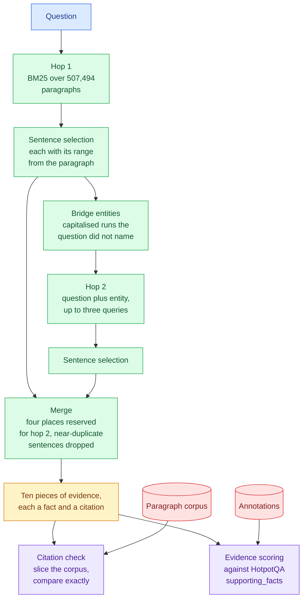

# pathquery

[](https://github.com/rajeev-chaurasia/pathquery/actions/workflows/ci.yml)

Multi-hop evidence retrieval where a citation is a document and a character
range, and the range is checked against the source rather than trusted.

> PathQuery finds evidence that single-hop retrieval cannot reach, by using
> what the first hop found to ask the second question, and every span it cites
> resolves to exactly the source text it claims, checked by offset rather than
> asserted.

The claim has two halves, and the evidence here holds one of them.

**Every citation resolves.** 24,000 citations across two runs, each one a
document and a character range, each one checked by slicing the corpus at that
range and comparing the result to the quoted text character for character. All
of them match. Shift every range by three characters and none of them do.

**The second hop does not pay for itself.** Following what the first hop found
retrieves slightly more complete evidence sets for bridge questions and slightly
less evidence overall. The threshold fixed before the run was a gain of 0.15 in
Recall@10; the measured change is a loss of 0.0049. That is published as a
miss, with the cause traced in [docs/known-misses.md](docs/known-misses.md).

The claim, the thresholds and the negative controls were fixed in
[PLAN.md](PLAN.md) and committed before the corpus was downloaded, which the
history shows.

## What a citation is

```python
def resolve(citation: Citation, corpus: Mapping[str, str]) -> Resolution:
    text = corpus.get(citation.document)
    if text is None:
        return Resolution.MISSING_DOCUMENT
    if citation.end <= citation.start or citation.end > len(text):
        return Resolution.OUT_OF_RANGE
    if text[citation.start : citation.end] != citation.quoted:
        return Resolution.TEXT_MISMATCH
    return Resolution.RESOLVED
```

That is the whole rule, in [`core/citation.py`](src/pathquery/core/citation.py).
Nothing is normalised, not whitespace and not case, because a comparison that
forgives a few characters is one that accepts a quote attributed to the sentence
beside the one it came from. A zero-length range is rejected, since an empty
string is found at every position of every document.

The offsets are never searched for. A paragraph is stored as HotpotQA's list of
sentences, and each sentence's range is computed from that list when the
paragraph is joined, so there is no second copy of the offsets to drift from the
text. Searching for a quote to find its position would return the first
occurrence, which is not necessarily the sentence that was scored.

## How a question is answered



A hop is a retrieval whose query was built from what the previous one returned.
Two retrievals issued from the original question alone are scored as single hop
however many requests they make. The two checks at the bottom share no code
with the retrieval above them: one reads only the corpus, the other only the
annotations.

## Results

One run of each system over 1,200 questions drawn by seed from the HotpotQA
development set, 963 bridge and 237 comparison, against a corpus of 507,494
paragraphs pooled from HotpotQA's distractor setting. Evidence is scored at the
sentence level against HotpotQA's own `supporting_facts`.

Every number below is recomputed by
[`script/validate_evidence.py`](script/validate_evidence.py) in CI from files
committed under `evidence/`: the annotations, every piece of evidence each
system returned, every citation, and the 11,236 source paragraphs those
citations point at. Nothing has to be downloaded to check them. Editing a
summary fails the build, and so does editing one sentence of a cited paragraph,
which breaks exactly the citations that quote it.

### The claim

| threshold, fixed in PLAN.md before the run | committed | measured | |
| --- | ---: | ---: | --- |
| multi-hop gain over single-hop, bridge Recall@10 | at least 0.15 | **-0.0049** | missed |
| citations resolving to their exact source span | 1.000 | **1.000** | held |
| shifted-offset control, citations resolving | at most 0.01 | **0.000** | held |
| shuffled-evidence control, Recall@10 | at most 0.02 | **0.000** | held |
| questions evaluated | 1,200 | 1,200 | held |
| corpus | about 500,000 | 507,494 | held |

### Single hop against multi-hop

| | single hop | multi-hop | change |
| --- | ---: | ---: | ---: |
| **bridge**, Recall@10 | 0.5303 | 0.5254 | -0.0049 |
| bridge, every supporting sentence found | 0.2087 | **0.2285** | +0.0197 |
| bridge, Recall@2 | 0.3254 | 0.3271 | +0.0017 |
| **comparison**, Recall@10 | 0.6828 | 0.6381 | -0.0448 |
| comparison, every supporting sentence found | 0.4262 | 0.3502 | -0.0760 |
| **all**, Recall@10 | 0.5604 | 0.5476 | -0.0128 |
| all, every supporting sentence found | 0.2517 | 0.2525 | +0.0008 |

The second hop does the thing it exists for on bridge questions: the share
where every supporting sentence was found rises by about two points. It pays for
that with partial hits elsewhere, and on comparison questions, which name both
entities up front and so gain nothing from following one, the places it takes
cost seven and a half points of complete evidence sets. Both systems are lexical
retrieval alone; the dense half of the fusion the plan describes is not built,
and the result should be read as what BM25 does when asked a second question.

### The controls

| control | what it does | expected | measured |
| --- | --- | --- | ---: |
| shifted offsets | every citation's range moved three characters, quoted text kept | resolution collapses | 0 of 12,000 resolve |
| shuffled evidence | each question scored against another question's annotations | recall falls to chance | 0.000 |
| single hop | the whole question asked once | the standing comparison | above |

The shifted citations fail two ways: 8,410 land on different text, and 3,590
run past the end of a short paragraph. A checker that let either kind through
would be comparing something other than the text it claims to.

### What went wrong first

The first multi-hop run scored within a thousandth of single hop, which looked
like a finding and was dead code. The merge put the first hop's evidence ahead
of the second's, and the first hop alone fills three times the places
available, so the second hop's evidence was truncated away for every question.
The second hop now has four reserved places.

The first validation run reported 2,334 single-hop citations pointing at
documents the repository did not contain. Both systems wrote the cited
paragraphs file, and the second overwrote the first. A summary with nothing
beside it would have published those citations as resolved.

3,249 titles arrive in HotpotQA with two different paragraph bodies. Keeping
whichever came first left three scored questions whose annotated sentence
indices pointed into a different paragraph, and nothing errored. A scored
question now keeps its own paragraph body, which applied to 63 titles.

## Running it

```bash
uv sync --all-groups
uv run pytest
uv run python -m script.validate_evidence
```

The validator needs nothing downloaded. To rebuild the corpus and rerun both
systems, which fetches about 360 MB from HuggingFace:

```bash
./script/fetch_corpus.sh
uv run pathquery build-corpus
uv run pathquery build-index
uv run pathquery baseline
uv run pathquery multihop
```

The corpus is drawn by seed, so a rebuild produces the same 1,200 questions and
the same paragraphs.

## Layout

| path | what is in it |
| --- | --- |
| `src/pathquery/core/` | the citation rule, evidence metrics, controls; standard library, numpy and pydantic only |
| `src/pathquery/corpus/` | HotpotQA reading, sentence offsets, corpus pooling |
| `src/pathquery/retrieve/` | BM25 over paragraphs, sentence selection with citations |
| `src/pathquery/hops/` | bridge entities, the second hop, the merge |
| `script/` | layer check, prose check, evidence validator, corpus fetch |
| `evidence/` | annotations, cited paragraphs, every run's output, and the summaries |

The boundary around `core` is enforced by
[`script/check_layers.py`](script/check_layers.py) in CI, so the rule deciding
whether a citation is true can be read and tested with no retriever in the way.

## What this is not

A resolving citation is a real quote in the right place, not evidence that the
quote supports anything; that is what the separate recall numbers measure. No
answers are generated and no answer accuracy is published. The corpus is
HotpotQA's pooled distractors, not full Wikipedia. See
[docs/non-goals.md](docs/non-goals.md) for the full list and
[docs/known-misses.md](docs/known-misses.md) for the gaps in the evidence.

The code is MIT licensed. The files under `evidence/` derived from HotpotQA are
CC BY-SA 4.0; see [evidence/ATTRIBUTION.md](evidence/ATTRIBUTION.md).
